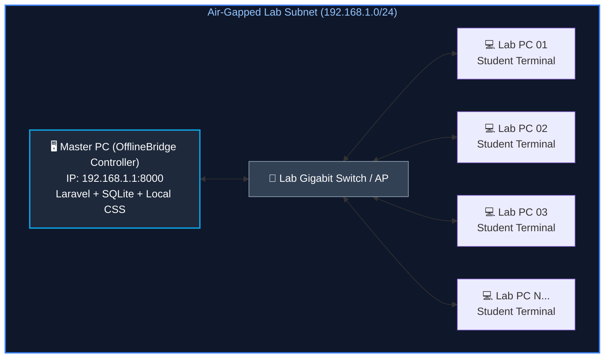

# 🌐 OfflineBridge — Master Control Panel

[](https://php.net)
[](https://laravel.com)
[](#)
[](#)
[](LICENSE)

> **OfflineBridge** is an all-in-one Master Control Panel engineered specifically for **air-gapped computer labs**, isolated academic intranets, and local subnet environments. It provides real-time client workstation tracking, application deployment feasibility assessment, local file and assignment sharing, and complete lab administration without relying on WAN or external internet connectivity.

---

## 📌 Table of Contents

- [Overview & Problem Statement](#-overview--problem-statement)
- [Key Features](#-key-features)
- [Application Compatibility & Feasibility Matrix](#-application-compatibility--feasibility-matrix)
- [System Architecture](#-system-architecture)
- [Tech Stack](#-tech-stack)
- [Installation & Quick Start](#-installation--quick-start)
- [Available Modules & Routes](#-available-modules--routes)
- [Directory Structure](#-directory-structure)
- [Configuration & Network Setup](#-configuration--network-setup)
- [License](#-license)

---

## 💡 Overview & Problem Statement

University computer labs and institutional testing environments frequently operate on **air-gapped or restricted LAN networks** to ensure security, prevent academic dishonesty, or compensate for unstable internet access. However, traditional management tools require cloud connections, external CDNs, or remote license servers.

**OfflineBridge** bridges this gap by acting as a self-hosted Master Node on the local subnet:
- **100% Offline-First**: No external CDN links, no cloud telemetry, and no remote asset loading.
- **Master Controller Hub**: Instructors and lab administrators monitor and distribute resources across all student workstations from a single unified interface.
- **Application Compatibility Intelligence**: Built-in test matrix and diagnostics for running complex engineering and networking tools (such as Cisco Packet Tracer, Wireshark, and offline code runners) inside an air-gapped LAN.

---

## 🚀 Key Features

### 🖥️ Master Dashboard & Telemetry
- Real-time LAN status indicators (Subnet status, Air-gap enforcement, DB synchronization).
- At-a-glance telemetry: Active workstations, registered students/instructors, lab storage consumption, and CPU/RAM load metrics.
- Built-in Dark / Light theme toggle with local state persistence (`localStorage`).

### 💻 Client Workstation Management
- Discovers and tracks connected lab workstations across the subnet (`192.168.1.0/24`).
- Monitors IP, MAC address, active student user session, and currently launched application per terminal.
- Live workstation status indicators (`Online`, `Idle`, `Offline`).

### 📦 Applications & Feasibility Engine
- Central software catalog for lab applications (Cisco Packet Tracer, Wireshark, Local Programming Judge).
- Detailed offline compatibility analysis identifying which sub-features pass, fail, or require local workarounds when disconnected from WAN.

### 👥 User & Role Access Control
- Manages student, instructor, and lab administrator credentials.
- Role-based permissions preventing unauthorized modifications during lab sessions.

### 📁 Local File & Assignment Distribution
- Offline distribution hub for lab sheets, manual PDFs, sample topologies (`.pkt` / `.pka`), and packet captures (`.pcapng`).
- Secure local submission inbox for student assignments.

### 📜 Real-Time Audit & Activity Logs
- Comprehensive logging of workstation connections, file transfers, and system events.
- Filterable event history for lab session tracking.

### 💾 Backup & Disaster Recovery
- Local snapshot creation and restoration for lab configurations and user submissions.
- Air-gapped database backups without cloud reliance.

---

## 🔬 Application Compatibility & Feasibility Matrix

One of OfflineBridge's core features is diagnosing and documenting offline compatibility for essential engineering software. Below is the test matrix for **Cisco Packet Tracer**:

| Feature / Subsystem | Internet Required? | LAN Subnet Required? | Test Result | Compatibility Note |
| :--- | :---: | :---: | :---: | :--- |
| **Topology Creation & Editing** | ❌ No | ❌ No | `PASS` | Routers, switches, PCs, and cabling work 100% offline. |
| **Device Configuration (CLI/GUI)** | ❌ No | ❌ No | `PASS` | Static IP, subnetting, VLANs, and routing protocols execute locally. |
| **Packet Simulation & Inspection** | ❌ No | ❌ No | `PASS` | ICMP/PDU step-by-step visual packet animation runs completely in RAM. |
| **Save & Load (.pkt / .pka)** | ❌ No | ❌ No | `PASS` | Local filesystem read/write for lab files is fully supported. |
| **Multiuser Peer-to-Peer over LAN** | ❌ No | ✔️ Yes | `PASS` | Direct TCP socket communication between student PCs across subnet. |
| **Online Account Authentication** | ✔️ Yes | ❌ No | `FAIL` | Cisco NetAcad login fails without WAN; bypass with Guest mode or local patch. |
| **Cloud Assessment & Grade Sync** | ✔️ Yes | ❌ No | `FAIL` | Cloud grading servers unreachable; submissions managed via OfflineBridge. |

---

## 🏗️ System Architecture



---

## 🛠️ Tech Stack

- **Backend**: [PHP 8.2+](https://www.php.net/) with [Laravel 12.x](https://laravel.com)
- **Database**: [SQLite](https://www.sqlite.org/) (lightweight, zero-config, portable single-file database) or MySQL
- **Frontend**: Blade Templating + **Zero-Dependency Vanilla CSS** (`public/css/app.css`)
  - No external CDNs or Google Fonts dependencies (guarantees instantaneous rendering on networks with no internet)
  - Native SVG iconography
  - Responsive CSS Grid and Flexbox layouts
- **Deployment**: Local PHP CLI server (`php artisan serve`) or Apache / Nginx on Master PC

---

## ⚡ Installation & Quick Start

### Prerequisites
- **PHP** >= 8.2 (with `pdo_sqlite`, `mbstring`, `openssl`, `curl` extensions enabled)
- **Composer** (v2.x)
- **Git**

### Step-by-Step Setup

1. **Clone the Repository**:
   ```bash
   git clone https://github.com/abutaleb08sae/Offline_Bridge.git
   cd Offline_Bridge
   ```

2. **Install PHP Dependencies**:
   ```bash
   composer install
   ```

3. **Configure Environment File**:
   ```bash
   cp .env.example .env
   php artisan key:generate
   ```

4. **Initialize Local Database**:
   ```bash
   # Ensure SQLite database file exists
   touch database/database.sqlite

   # Run migrations
   php artisan migrate
   ```

5. **Start the Master Controller Server**:
   ```bash
   # Run on localhost
   php artisan serve --port=8000

   # Or bind to your LAN IP so other workstations can access it:
   php artisan serve --host=0.0.0.0 --port=8000
   ```

6. **Access OfflineBridge**:
   - On the Master PC: `http://127.0.0.1:8000`
   - On Student Workstations: `http://<MASTER_PC_LAN_IP>:8000` (e.g., `http://192.168.1.1:8000`)

---

## 🧭 Available Modules & Routes

| Route | Name | Description |
| :--- | :--- | :--- |
| `/` | `dashboard` | Master Dashboard Overview with live telemetry and system health. |
| `/clients` | `clients.index` | Connected Workstation monitoring (IPs, MACs, active apps). |
| `/applications` | `applications.index` | Software catalog and offline feasibility compatibility reports. |
| `/users` | `users.index` | User management (Administrators, Instructors, Students). |
| `/files` | `files.index` | Local lab material distribution and assignment collection. |
| `/activities` | `activities.index` | Real-time session monitoring and audit log entries. |
| `/logs` | `logs.index` | System diagnostic logs and connection events. |
| `/settings` | `settings.index` | Subnet configuration, air-gap toggles, and system preferences. |
| `/backup` | `backup.index` | Local snapshot generation and database restoration. |

---

## 📂 Directory Structure

```plaintext
Offline_Bridge/
├── app/
│   ├── Http/Controllers/
│   │   └── NavigationController.php   # Handles navigation and view rendering
│   └── Services/
│       └── MockDataService.php        # Telemetry, clients, and feasibility datasets
├── database/
│   ├── database.sqlite                # Portable local database
│   └── migrations/                    # Database schema migrations
├── public/
│   ├── css/
│   │   └── app.css                    # Complete standalone CSS (No CDN required)
│   └── index.php                      # Application entrypoint
├── resources/
│   └── views/
│       ├── layouts/
│       │   └── app.blade.php          # Main layout with sidebar & theme script
│       ├── dashboard.blade.php        # Master overview page
│       └── pages/                     # Individual module views
│           ├── activities.blade.php
│           ├── applications.blade.php
│           ├── backup.blade.php
│           ├── clients.blade.php
│           ├── files.blade.php
│           ├── logs.blade.php
│           ├── settings.blade.php
│           └── users.blade.php
├── routes/
│   └── web.php                        # Master web route definitions
└── .env                               # Environment & database configuration
```

---

## 🔒 Configuration & Network Setup

### Binding to Local Subnet
To allow student workstations in the lab to access the Master Control Panel, ensure your Master PC firewall permits inbound traffic on port `8000` (or `80`), and run:
```bash
php artisan serve --host=0.0.0.0 --port=8000
```

### Air-Gap Enforcement
In [`.env`](file:///.env), ensure the application is configured to run fully isolated:
```ini
APP_ENV=local
APP_DEBUG=false
DB_CONNECTION=sqlite
SESSION_DRIVER=database
CACHE_STORE=database
QUEUE_CONNECTION=database
```

---

## 📄 License

This project is open-source software licensed under the [MIT License](LICENSE).
